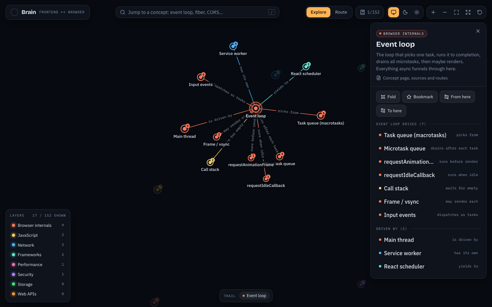
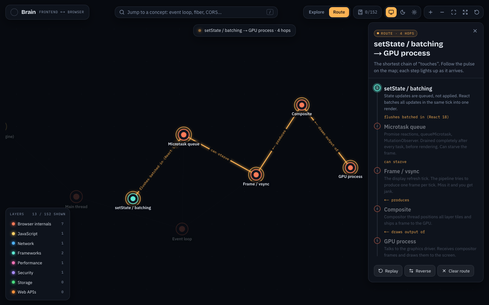
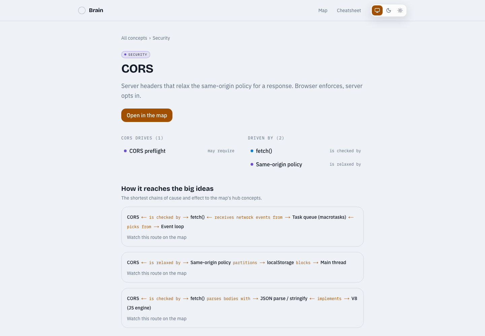

# Brain

**A free map of how frontend development touches the browser.** Click a concept to unfold what it drives and what
drives it, or pick two concepts and follow the shortest chain of cause and effect between them, narrated hop by hop.
No login, nothing to install, works offline after the first visit.



## What you can do

- **Explore.** 152 concepts across eight layers: browser internals, JavaScript, network, frameworks, performance,
  security, storage and Web APIs. Every relation is named: _microtask queue_ → **can starve** → _frame_.
- **Route.** Pick a start and a destination. The map draws the shortest path and the card explains each hop.
  Routes are links you can share: `/explore?from=set_state&to=gpu_process`.
- **Look it up.** Every concept has a page with its relations, routes to the big ideas and a source. The cheatsheet
  lists everything on one printable page. Both work without JavaScript and with a screen reader.
- **Keep your place.** Views and bookmarks stay in your browser. Export them to a file to move to another device.

| Route mode                                                                      | Concept page (light theme)                             |
| ------------------------------------------------------------------------------- | ------------------------------------------------------ |
|  |  |

## How it is built

| Path                    | What it is                                                                  |
| ----------------------- | --------------------------------------------------------------------------- |
| `apps/web`              | Next.js 16 app: the map, concept pages, cheatsheet, offline shell           |
| `packages/content`      | Every fact as YAML, compiled with Zod and validated as a graph at build     |
| `packages/graph-engine` | Framework-free graph model, shortest path, force layout and canvas renderer |
| `packages/config`       | Shared TypeScript, ESLint and Prettier configuration                        |
| `docs/`                 | PRD, system design, ADRs, backlog, runbooks, journal and retros             |

The map is a Canvas 2D renderer driven by d3-force, outside React's render loop. Engine state lives in Zustand,
progress in Redux Toolkit with IndexedDB. Every page is static. The reasons for each choice are in
[`docs/adr/`](docs/adr/).

**Quality gates on every PR:** typecheck, type-aware lint with strict accessibility rules, 146 unit tests, 31
Playwright tests including axe scans in both themes, offline and phone layout, a per-page JavaScript budget, and a
frame-timing check. The content build fails on any broken graph rule or missing source.

## Run it locally

Requirements: Node 24 (see `.nvmrc`) and pnpm 11 (`corepack enable` picks the pinned version).

```sh
pnpm install
pnpm dev            # http://localhost:3000
```

```sh
pnpm check          # typecheck, lint and unit tests: what CI runs first
pnpm build          # production build, including the content validator
NEXT_PUBLIC_E2E=1 pnpm build && pnpm --filter @brain/web e2e   # end-to-end suite
```

## Contributing

Most contributions are content: a missing concept, a relation that is wrong, a clearer summary. See
[`CONTRIBUTING.md`](CONTRIBUTING.md). Report security issues privately, as described in [`SECURITY.md`](SECURITY.md).

## Licence

The code is [MIT](LICENSE). The concept content in `packages/content/data` is
[CC BY 4.0](packages/content/data/LICENSE): reuse it freely with credit.

## How the project is run

Like a product team's project: a problem statement, decisions with reasons, tickets with acceptance criteria,
reviews, retros and a journal of what went wrong. Start at [`docs/README.md`](docs/README.md), or follow the work on
the [project board](https://github.com/users/aadarshjr123/projects/3).
